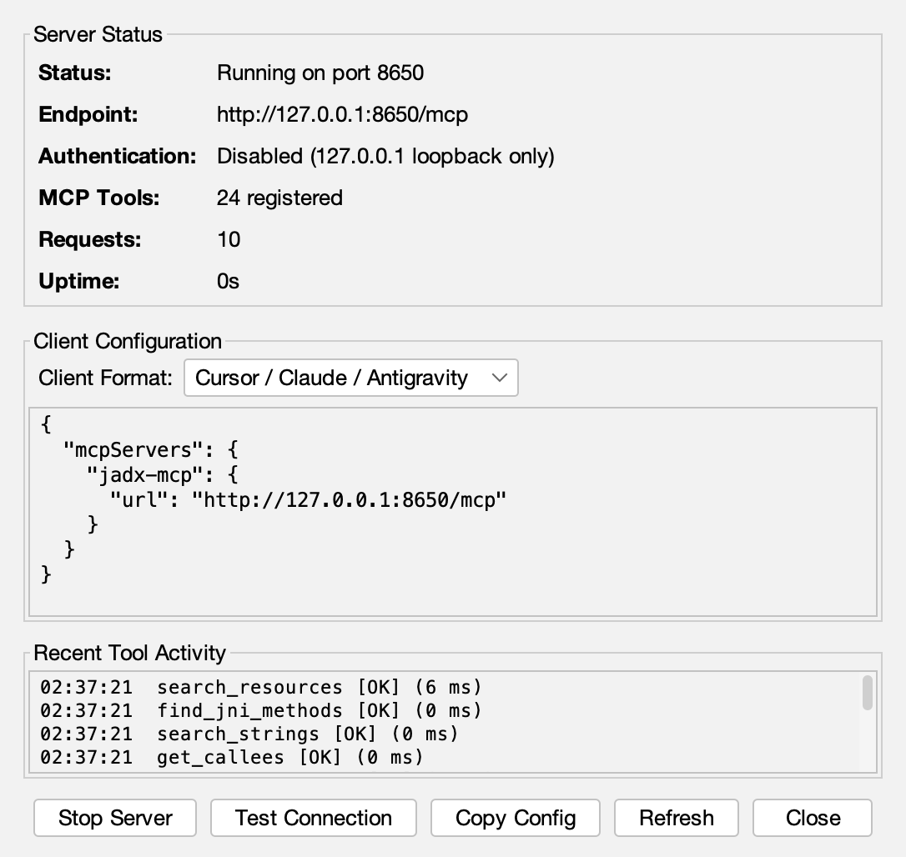
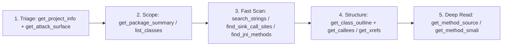

# Real-World Scenarios & Live Examples

This guide shows complete end-to-end interactions with `jadx-mcp`: **the prompt you give your AI client**, **the MCP tools called**, **actual JSON outputs** captured from `jadx-mcp` running on JADX's `small.apk`, and **the model's final answer**.

---

## Server Status & Live Activity Monitor

When `jadx-gui` is running, **Plugins → JADX MCP Server Status** displays the active endpoint, registered tool count, client configuration snippet, and a live **Recent Tool Activity** feed:



---

## Recommended Agent Workflow



---

## Scenario 1: Initial Triage & Attack Surface Audit

### User Prompt

> "Give me a quick overview of the loaded APK, check its manifest security flags and exported components, and summarize the main app package without decompiling everything."

### Tool Calls & Live Responses

#### 1. `get_project_info` (`{}`)

```json
{
  "ready": true,
  "classCount": 8,
  "methodCount": 2,
  "fieldCount": 9,
  "resourceCount": 8,
  "nativeLibs": [],
  "inputFiles": ["small.apk"]
}
```

#### 2. `get_attack_surface` (`{}`)

```json
{
  "packageName": "io.github.skylot.android.smallapp",
  "permissions": [],
  "dangerousPermissions": [],
  "debuggable": true,
  "allowBackup": true,
  "usesCleartextTraffic": false,
  "exportedComponents": [
    {
      "type": "activity",
      "name": "io.github.skylot.android.smallapp.MainActivity",
      "protected": false,
      "deepLinks": []
    }
  ],
  "unprotectedExportedCount": 1
}
```

#### 3. `get_package_summary` (`{"packagePrefix": "io.github.skylot.android.smallapp"}`)

```json
{
  "packagePrefix": "io.github.skylot.android.smallapp",
  "classCount": 2,
  "totalMethods": 2,
  "totalFields": 0,
  "subpackages": [],
  "classes": [
    {
      "className": "io.github.skylot.android.smallapp.MainActivity",
      "superClass": "android.app.Activity",
      "methodCount": 2,
      "fieldCount": 0
    },
    {
      "className": "io.github.skylot.android.smallapp.R",
      "methodCount": 0,
      "fieldCount": 0
    }
  ],
  "offset": 0,
  "limit": 50,
  "hasMore": false,
  "nextOffset": -1
}
```

### Model Response

> **Project Summary (`small.apk`)**
> - **Scale:** 8 classes, 2 methods, 9 fields, 8 resources, and no native `.so` libraries.
> - **Main Package (`io.github.skylot.android.smallapp`):** Contains 2 classes (`MainActivity` extending `android.app.Activity` with 2 methods, and `R`).
> - **Manifest & Attack Surface:**
>   - `android:debuggable="true"` and `android:allowBackup="true"` are both enabled (should be disabled for release builds).
>   - `usesCleartextTraffic` is `false` and no dangerous permissions are declared.
>   - 1 unprotected exported component: `io.github.skylot.android.smallapp.MainActivity` (launcher activity).

---

## Scenario 2: String Search → Outline → Call Graph → Method Source

### User Prompt

> "Find where the string `"Hello"` is used in this APK, inspect the enclosing class structure, list what that method calls, and show me only that method's decompiled Java code."

### Tool Calls & Live Responses

#### 1. `search_strings` (`{"query": "Hello", "limit": 5}`)

```json
{
  "items": [
    {
      "value": "Hello",
      "className": "io.github.skylot.android.smallapp.MainActivity",
      "methodName": "onCreate",
      "shortId": "onCreate(Landroid/os/Bundle;)V"
    }
  ],
  "offset": 0,
  "limit": 5,
  "total": 1,
  "hasMore": false,
  "nextOffset": -1,
  "timedOut": false
}
```

#### 2. `get_class_outline` (`{"className": "io.github.skylot.android.smallapp.MainActivity"}`)

```json
{
  "className": "io.github.skylot.android.smallapp.MainActivity",
  "rawName": "io.github.skylot.android.smallapp.MainActivity",
  "packageName": "io.github.skylot.android.smallapp",
  "superClass": "android.app.Activity",
  "interfaces": [],
  "fields": [],
  "methods": [
    {
      "name": "<init>",
      "shortId": "<init>()V",
      "returnType": "void",
      "argTypes": []
    },
    {
      "name": "onCreate",
      "shortId": "onCreate(Landroid/os/Bundle;)V",
      "returnType": "void",
      "argTypes": ["android.os.Bundle"]
    }
  ]
}
```

#### 3. `get_callees` (`{"className": "io.github.skylot.android.smallapp.MainActivity", "methodName": "onCreate"}`)

```json
{
  "className": "io.github.skylot.android.smallapp.MainActivity",
  "methodName": "onCreate",
  "shortId": "onCreate(Landroid/os/Bundle;)V",
  "callees": [
    {
      "className": "Landroid/app/Activity;",
      "methodName": "onCreate",
      "returnType": "V",
      "argCount": 1
    },
    {
      "className": "Landroid/app/Activity;",
      "methodName": "setContentView",
      "returnType": "V",
      "argCount": 1
    },
    {
      "className": "Landroid/util/Log;",
      "methodName": "i",
      "returnType": "I",
      "argCount": 2
    }
  ]
}
```

#### 4. `get_method_source` (`{"className": "io.github.skylot.android.smallapp.MainActivity", "methodName": "onCreate"}`)

```json
{
  "className": "io.github.skylot.android.smallapp.MainActivity",
  "ambiguous": false,
  "name": "onCreate",
  "shortId": "onCreate(Landroid/os/Bundle;)V",
  "fullName": "io.github.skylot.android.smallapp.MainActivity.onCreate",
  "mode": "java",
  "truncated": false,
  "code": "/* JADX INFO: loaded from: classes.dex */\npublic class MainActivity extends Activity {\n    @Override // android.app.Activity\n    public void onCreate(Bundle savedInstanceState) {\n        super.onCreate(savedInstanceState);\n        setContentView(R.layout.activity_main);\n        Log.i(\"SmallApp\", \"Hello\");\n    }"
}
```

### Model Response

> The string `"Hello"` appears in `io.github.skylot.android.smallapp.MainActivity.onCreate(Bundle)`:
> - **Class structure:** `MainActivity extends android.app.Activity` with two methods (`<init>()` and `onCreate(Bundle)`).
> - **Bytecode callees:** Calls `Activity.onCreate`, `Activity.setContentView`, and `Log.i`.
> - **Decompiled behavior:** Initializes the activity, inflates `R.layout.activity_main`, and logs `"Hello"` under the tag `"SmallApp"`.

---

## Scenario 3: Searching Text Resources

### User Prompt

> "Search across all decoded XML, manifest, and text resources for `"package"` so I can see which files define or reference it."

### Tool Call & Live Response

#### `search_resources` (`{"query": "package", "limit": 5}`)

```json
{
  "items": [
    {
      "name": "AndroidManifest.xml",
      "type": "MANIFEST",
      "line": 7,
      "preview": "package=\"io.github.skylot.android.smallapp\""
    }
  ],
  "offset": 0,
  "limit": 5,
  "total": 1,
  "hasMore": false,
  "nextOffset": -1,
  "timedOut": false
}
```

### Model Response

> Found 1 match across text resources:
> - `AndroidManifest.xml` (line 7): `package="io.github.skylot.android.smallapp"`

---

## Scenario 4: Built-in Security Audit Prompt

MCP clients that support `prompts/list` and `prompts/get` can invoke built-in workflows directly (for example `/security_audit` with optional `packagePrefix`).

### User Prompt (via Built-in `security_audit` Prompt)

> `prompts/get` → `security_audit` (`packagePrefix: "com.example.auth"`)

### Prompt Expansion Sent to the Model

```text
Perform a structured security audit of the loaded APK:
1. Call get_project_info and get_attack_surface to inspect permissions, debuggable/cleartext flags, and unprotected exported components.
2. Call find_sink_call_sites (category='all', excludeLibraries=true, excludeGenerated=true).
3. Call list_classes (Focus on packagePrefix 'com.example.auth' with excludeLibraries=true and excludeGenerated=true.) and inspect high-risk entry points with get_class_outline / get_method_source.
4. Summarize concrete findings with class/method locations and severity.
```
