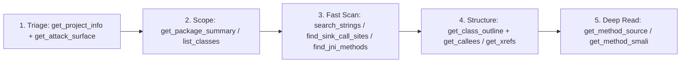

# Real-World Scenarios & Live Examples

This guide walks through practical reverse-engineering workflows with `jadx-mcp`, using **actual JSON outputs** captured from `jadx-mcp` running against JADX's `small.apk` sample.

---

## Server Status & Live Activity Monitor

When `jadx-gui` is running, **Plugins → JADX MCP Server Status** displays the active endpoint, registered tool count, client configuration snippet, and a live **Recent Tool Activity** feed:


---

## Recommended Agent Workflow



---

## Scenario 1: Initial Triage & Attack Surface Audit

Start by checking the loaded project size and inspecting `AndroidManifest.xml` for exported components and security flags.

### 1. `get_project_info`

```json
{
  "ready": true,
  "classCount": 8,
  "methodCount": 2,
  "fieldCount": 9,
  "resourceCount": 8,
  "nativeLibs": [],
  "inputFiles": ["small.apk"]
}
```

### 2. `get_attack_surface`

```json
{
  "packageName": "io.github.skylot.android.smallapp",
  "permissions": [],
  "dangerousPermissions": [],
  "debuggable": true,
  "allowBackup": true,
  "usesCleartextTraffic": false,
  "exportedComponents": [
    {
      "type": "activity",
      "name": "io.github.skylot.android.smallapp.MainActivity",
      "protected": false,
      "deepLinks": []
    }
  ],
  "unprotectedExportedCount": 1
}
```

### 3. `get_package_summary` (`packagePrefix: "io.github.skylot.android.smallapp"`)

Summarize a package's classes, method/field counts, and subpackages without triggering decompilation:

```json
{
  "packagePrefix": "io.github.skylot.android.smallapp",
  "classCount": 2,
  "totalMethods": 2,
  "totalFields": 0,
  "subpackages": [],
  "classes": [
    {
      "className": "io.github.skylot.android.smallapp.MainActivity",
      "superClass": "android.app.Activity",
      "methodCount": 2,
      "fieldCount": 0
    },
    {
      "className": "io.github.skylot.android.smallapp.R",
      "methodCount": 0,
      "fieldCount": 0
    }
  ],
  "offset": 0,
  "limit": 50,
  "hasMore": false,
  "nextOffset": -1
}
```

---

## Scenario 2: String Search → Outline → Call Graph → Method Source

Instead of decompiling entire classes, locate constant strings in raw bytecode first, inspect the class outline, verify callees from bytecode, and decompile only the target method.

### 1. `search_strings` (`query: "Hello"`)

```json
{
  "items": [
    {
      "value": "Hello",
      "className": "io.github.skylot.android.smallapp.MainActivity",
      "methodName": "onCreate",
      "shortId": "onCreate(Landroid/os/Bundle;)V"
    }
  ],
  "offset": 0,
  "limit": 5,
  "total": 1,
  "hasMore": false,
  "nextOffset": -1,
  "timedOut": false
}
```

### 2. `get_class_outline` (`className: "io.github.skylot.android.smallapp.MainActivity"`)

```json
{
  "className": "io.github.skylot.android.smallapp.MainActivity",
  "rawName": "io.github.skylot.android.smallapp.MainActivity",
  "packageName": "io.github.skylot.android.smallapp",
  "superClass": "android.app.Activity",
  "interfaces": [],
  "fields": [],
  "methods": [
    {
      "name": "<init>",
      "shortId": "<init>()V",
      "returnType": "void",
      "argTypes": []
    },
    {
      "name": "onCreate",
      "shortId": "onCreate(Landroid/os/Bundle;)V",
      "returnType": "void",
      "argTypes": ["android.os.Bundle"]
    }
  ]
}
```

### 3. `get_callees` (`MainActivity.onCreate`)

```json
{
  "className": "io.github.skylot.android.smallapp.MainActivity",
  "methodName": "onCreate",
  "shortId": "onCreate(Landroid/os/Bundle;)V",
  "callees": [
    {
      "className": "Landroid/app/Activity;",
      "methodName": "onCreate",
      "returnType": "V",
      "argCount": 1
    },
    {
      "className": "Landroid/app/Activity;",
      "methodName": "setContentView",
      "returnType": "V",
      "argCount": 1
    },
    {
      "className": "Landroid/util/Log;",
      "methodName": "i",
      "returnType": "I",
      "argCount": 2
    }
  ]
}
```

### 4. `get_method_source` (`MainActivity.onCreate`)

```json
{
  "className": "io.github.skylot.android.smallapp.MainActivity",
  "ambiguous": false,
  "name": "onCreate",
  "shortId": "onCreate(Landroid/os/Bundle;)V",
  "fullName": "io.github.skylot.android.smallapp.MainActivity.onCreate",
  "mode": "java",
  "truncated": false,
  "code": "/* JADX INFO: loaded from: classes.dex */\npublic class MainActivity extends Activity {\n    @Override // android.app.Activity\n    public void onCreate(Bundle savedInstanceState) {\n        super.onCreate(savedInstanceState);\n        setContentView(R.layout.activity_main);\n        Log.i(\"SmallApp\", \"Hello\");\n    }"
}
```

---

## Scenario 3: Resource Search (`search_resources`)

Search across decoded XML, manifest, JSON, HTML, and properties files without reading every resource individually:

### `search_resources` (`query: "package"`)

```json
{
  "items": [
    {
      "name": "AndroidManifest.xml",
      "type": "MANIFEST",
      "line": 7,
      "preview": "package=\"io.github.skylot.android.smallapp\""
    }
  ],
  "offset": 0,
  "limit": 5,
  "total": 1,
  "hasMore": false,
  "nextOffset": -1,
  "timedOut": false
}
```
